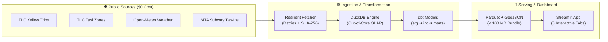

<div align="center">

# 🚕 MetroPulse
### **NYC Multimodal Urban Mobility & Intelligence Engine**
*Turning 10.2M+ Yellow Taxi Trips, MTA Subway Tap-Ins & Micro-Climate Data into Executive Insights (Q2 2024)*

[](https://github.com/NiharikaRai05/MetroPulse/actions)
[](https://share.streamlit.io)
[](https://www.python.org/)
[](https://duckdb.org/)
[](https://www.getdbt.com/)
[](LICENSE)

</div>

---

## 🌟 Overview at a Glance

**MetroPulse** is a lightweight, zero-cost, end-to-end analytical data platform that ingests, models, and visualizes multimodal urban mobility patterns across New York City during **Q2 2024 (April 1 – June 30, 2024)**.

```text
 10.25M+ Metered Taxi Rides  |  470+ Subway Stations  |  2,184 Hourly Weather Records  |  265 Taxi Zones
                      ⚡ Powered by DuckDB + dbt + Streamlit in under 100MB ⚡
```

---

## 🎯 6 Interactive Executive Views

| View | Core Questions Answered | Key Visuals |
|---|---|---|
| 📊 **Executive Pulse** | What is the total market volume, revenue yield, and subway baseline? | Macro KPI Cards, Demand Breakdown, Hourly Trend Curves |
| ⏰ **Temporal Dynamics** | When does congestion spike? How do weekend vs weekday demand patterns differ? | Day-of-Week × Hour Heatmap, Diurnal Speed Analysis |
| 🗺️ **Geographic & Zones** | Which corridors drive the highest taxi volume and fare yield? | Interactive Choropleth Map, Top Route Pairs, Airport Corridors |
| 💳 **Fares & Payments** | How are fares composed, and what are real credit card tipping patterns? | Fare Waterfall Breakdown, Tip Yield Distribution |
| 🌦️ **Weather & Transit** | Does heavy rain cause a modal shift from subways to taxis? | Precipitation vs Demand Scatter, Rainy Day Disruption Tracker |
| 🛡️ **Data Quality** | Are there data anomalies, timestamp inversions, or impossible speeds? | Live Anomaly Audit Table (`mart_quality`), Quarantined Record Metrics |

---

## 🏛️ Architecture & Data Pipeline



---

## 🚀 Quickstart (Run Locally in 60 Seconds)

### 1. Clone & Install
```bash
git clone https://github.com/NiharikaRai05/MetroPulse.git
cd MetroPulse
pip install -r requirements.txt
```

### 2. Launch the App
```bash
streamlit run dashboard/app.py
```
👉 Open **[http://localhost:8501](http://localhost:8501)** in your browser.

---

## ⚡ One-Command Full Pipeline Rebuild

To rerun ingestion, execute all dbt models, run tests, and re-export the data bundle:

```bash
make build
```

| Command | Action |
|---|---|
| `make ingest` | Download source Parquet, CSV, Weather & MTA feeds with SHA-256 verification |
| `make transform` | Run dbt staging, intermediate, and marts models inside DuckDB |
| `make test` | Run comprehensive dbt schema tests + `pytest` suite |
| `make export` | Export optimized analytical marts to `dashboard/data/` |
| `make dash` | Launch local Streamlit executive dashboard |

---

## 📐 Key Methodological Principles

- 💡 **Market Turnover ≠ Operator Profit:** Taxi fare sums represent gross passenger travel expenditure, not fleet net profits.
- 🛡️ **Zero Hardcoded Numbers:** Every dashboard KPI and chart is dynamically computed from Parquet marts.
- 🚫 **No Simpson's Paradox:** Averages (speeds, tip rates, fare per mile) are re-aggregated dynamically from additive sums and counts.
- 💳 **Accurate Tip Yield:** Gratuities are evaluated exclusively on credit card rides (`payment_type = 1`), eliminating cash tip distortion.

---

## 📂 Project Structure

```text
MetroPulse/
├── dashboard/              # 🎨 Streamlit application & modern UI modules
│   ├── app.py              # Main dashboard entrypoint
│   ├── theme.py            # Glassmorphic executive styling & color palettes
│   ├── pages_modules/      # 6 Modular interactive views
│   └── data/               # Compressed Parquet marts & GeoJSON (< 100 MB)
├── dbt_project/            # 🧱 dbt transformation models & schema tests
│   ├── models/staging/     # stg_taxi_trips, stg_mta, stg_weather, stg_zones
│   ├── models/intermediate/# int_trips_flagged, int_multimodal_hourly
│   └── models/marts/       # mart_cube, mart_quality, mart_executive, etc.
├── ingestion/              # 📥 Resilient ingestion scripts with backoff
├── docs/                   # 📑 Deployment guide, metric dictionary & memos
├── tests/                  # 🧪 End-to-end integration & validation test suite
└── Makefile                # ⚡ Single-command lifecycle orchestration
```

---

## 🔗 Documentation

- 📄 **[Executive Defense Memo](docs/executive_memo.md)** — Strategic initiatives & pilot experiment proposals.
- 📖 **[Metric Dictionary & Lineage](docs/metric_dictionary.md)** — Formulas, dimensions, grains, and assumptions.
- 🚀 **[Public Deployment Guide](docs/deployment_guide.md)** — Step-by-step free hosting on Streamlit Cloud & Hugging Face.
- 🤖 **[AI Usage Log](AI_USAGE.md)** — Disclosure and human validation log.

---

<div align="center">
Made with ❤️ for NYC Multimodal Transportation Analytics • <b>MIT License</b>
</div>
